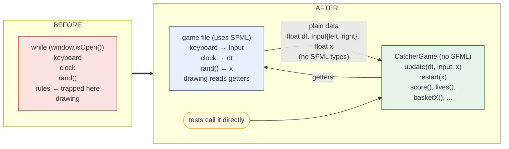

# How to split game logic from SFML (so you can test it)

Most of the games in this repository do everything inside one loop: read the keyboard, move things, apply the rules, and draw. The **rules** (what happens when the ball hits a block, when a row is full, when a fruit is caught) are the part worth testing, but you can't test them while they are trapped inside a loop that needs a window.

This guide walks through splitting a small game, one safe step at a time, until the rules live in their own class with no SFML. Then it shows how to test that class.

The example game is **Catcher**: move a basket left and right to catch falling fruit. A catch scores a point, a miss costs a life, and after three misses it's game over. It is *not* one of the 16 games, so you can copy the method but not the answer.

| File | What it is |
|------|------------|
| [howto_split/before/catcher.cpp](howto_split/before/catcher.cpp) | **Before**: rules, SFML, keyboard, clock and `rand()` all mixed in one loop. Not testable. |
| [howto_split/after/CatcherGame.h](howto_split/after/CatcherGame.h) | **After**: the rules in a class with no SFML. Testable. |
| [howto_split/after/catcher.cpp](howto_split/after/catcher.cpp) | **After**: the game file. It only reads input, calls the class, and draws. |
| [howto_split/after/CatcherGame_test.cpp](howto_split/after/CatcherGame_test.cpp) | **After**: unit tests for the class. No window opens. |

Read the two `catcher.cpp` files side by side before you go on. They play exactly the same.

### Playing Catcher

Each version is its own CMake target, built by the same project as the 16 games: `catcher_before`, `catcher_after`, and `CatcherTests` for the unit tests. Configure the project as the [README](README.md) describes, then:

```sh
cmake --build build --config Release --target catcher_before catcher_after CatcherTests
```

The executables go in `build/bin/` (or `build/bin/Release/` with Visual Studio). Catcher needs no image files, so you can run it from any folder:

```sh
build/bin/catcher_before      # Windows: build\bin\Release\catcher_before.exe
build/bin/catcher_after
```

In Visual Studio or VS Code (CMake Tools), pick `catcher_before` or `catcher_after` as the startup / launch target instead.

**Controls:** Left and Right arrows move the basket. Space restarts after game over. The score and lives are shown in the window title.

The tests run with the rest of the suite (`ctest --test-dir build -C Release --output-on-failure`). To run only the Catcher tests, add `-R "^Catcher\."`.

---

## Why the "before" version can't be tested

Try writing one test for [before/catcher.cpp](howto_split/before/catcher.cpp). Take a simple rule: *a fruit that falls past the bottom costs a life.* A unit test has three parts. Set up a situation, run the code once, and check the result. Every part runs into a problem:

| To test it you need to... | But in the before version... |
|------------------|------------------------------|
| **Call the rule** | There's nothing to call. The rule is a few lines in the middle of `main()`'s `while` loop. Calling `main()` opens a window and loops until a person closes it. You can't run "one frame". |
| **Set up the situation** (fruit just above the bottom, 3 lives) | `lives` and `score` are local variables inside `main()`, so nothing outside can set them. The fruit's position isn't even a variable: it lives inside an SFML `CircleShape`. |
| **Control the input** (no keys pressed) | The code asks the real keyboard (`Keyboard::isKeyPressed`). A test can't press or release keys. |
| **Control time** | `dt` comes from a real `Clock`, so how far the fruit falls in one frame depends on how fast the computer is. Run it twice and you get different numbers. |
| **Predict what happens next** | After a catch or miss, the fruit moves to `rand() % 380`. The test can't know where it will be, so it can't check it. |
| **Check the result** (lives is now 2) | The only place `lives` is shown is the window title and the screen. A test would have to read text out of a window. |
| **Run without graphics** | Every line needs SFML and a window. The `Tests` project doesn't link SFML (on purpose), and a test machine may not even have a screen. |

None of these problems is about the rule itself. The rule is just `if (y > 500) lives--;`, which is easy. The problem is what the rule is *tangled with*: the window, the keyboard, the clock, `rand()` and SFML shapes.

Each step below removes one of these problems:

| Problem | Removed by |
|---------|-----------|
| State hidden in SFML objects | Step 1: take the state out of SFML objects |
| Real keyboard | Step 3: turn input into plain data |
| Real clock, `rand()` | Step 4: pass in time and randomness |
| SFML types in the rules (`getGlobalBounds`, `FloatRect`) | Step 5: replace SFML types with your own |
| No way to call one frame | Step 6: gather the rules into one function |
| Local variables nothing can set or read; needs SFML to compile | Step 7: move it into its own header and make it a class |

After that, the same test is a few lines long. This one is from [CatcherGame_test.cpp](howto_split/after/CatcherGame_test.cpp):

```cpp
TEST(CatcherGame, FruitAwayFromBasketIsMissedAndCostsALife)
{
    CatcherGame game(0);  // basket starts at x 160..240, so this fruit misses

    int frame = 0;
    while (true)
    {
        game.update(0.1f, NO_KEYS, 0);
        frame++;
        // caught, missed, or too many frames (the frame limit stops a runaway loop if the rule is broken)
        bool finished = game.score() > 0 || game.lives() < 3 || frame >= 100;
        if (finished) break;
    }

    EXPECT_EQ(0, game.score());
    EXPECT_EQ(2, game.lives());
}
```

No window, no keyboard, no clock, no `rand()`. The fruit's starting x is passed in (`0`), so the test knows it will miss.

---

## The idea





The game file becomes a thin **shell** around the class. Everything SFML (the window, the keyboard, the clock, the shapes) stays in the shell. Everything that decides *what happens* moves into the class. The two talk only through **plain data**: `float`, `int`, `bool` and small structs you write yourself.

---

## Step 0 – Before you change anything

### 0a. Write the manual test script

You can't write unit tests yet (that's the whole problem), so your safety net while splitting is a **manual test script**: short scenarios you play by hand after every step. For Catcher:

1. **Catch:** stand under a fruit. *Expected:* score goes up by 1, a new fruit appears at the top.
2. **Miss:** move away from a fruit. *Expected:* lives go down by 1.
3. **Walls:** hold Left for 2 seconds. *Expected:* the basket stops at the left edge. Same for Right.
4. **Speed:** catch 5 fruits. *Expected:* fruit falls noticeably faster.
5. **Game over:** miss 3 times. *Expected:* everything stops. Space starts a new game with score 0 and 3 lives.

### 0b. Write the test list

Now write the rules down as plain English sentences, one rule per line. This is your **test list**. You can't run these as tests yet, but each line will become a unit test after the split.

```
- A new game has 3 lives and score 0.
- The first fruit starts at the top.
- Holding Left moves the basket left at 300 pixels per second. Same for Right.
- The basket can't leave the screen on either side.
- Fruit falls at 100 pixels per second, plus 10 for every point scored.
- A fruit that touches the basket scores 1 and a new fruit starts at the top.
- A fruit that falls off the bottom costs 1 life and a new fruit starts at the top.
- At 0 lives the game is over and nothing moves.
- Restarting gives 3 lives and score 0. (The basket stays where it was!)
```

The last line was found by *playing* the original, not by guessing. Write down what the game **does**, not what you think it should do.

> **Tip:** the test list also designs your class for you. To test "a new game has 3 lives", the class needs a `lives()` getter. To test "holding Left moves the basket", the class needs a way to be told that Left is held. Every line tells you something the class must have.

### 0c. Label every line of the loop

Go through the loop and label each line with what it depends on:

| Label | Means | Where it goes after the split |
|-------|-------|-------------------------------|
| **RULE** | game logic: moving, scoring, collisions | into the class |
| **KEY** | keyboard or mouse | stays in the game file, passed in as plain data |
| **TIME** | `Clock`, `dt`, timers | `dt` is passed in as a `float` |
| **RAND** | `rand()` | stays in the game file, the *result* is passed in |
| **DRAW** | shapes, sprites, `window.draw` | stays in the game file |

Part of Catcher's loop, labelled:

```cpp
float dt = clock.restart().asSeconds();                                    // TIME
if (Keyboard::isKeyPressed(Keyboard::Key::Left)) basket.move({-300*dt,0}); // KEY + RULE + DRAW (!)
if (basket.getPosition().x < 0) basket.setPosition({0, 470});              // RULE + DRAW (!)
fruit.move({0, (100 + score * 10) * dt});                                  // RULE + DRAW (!)
if (fruit.getGlobalBounds().findIntersection(basket.getGlobalBounds()))    // RULE + DRAW (!)
{ score++; fruit.setPosition({float(rand() % 380), 0}); }                  // RULE + RAND + DRAW (!)
```

Lines with **more than one label** are the ones to untangle. Each step below removes one kind of mix-up.

---

## When do I write the tests: before or after the split?

**Both, in different forms.**

| When | What you do | Why |
|------|-------------|-----|
| **Before** splitting | Manual test script + test list (Step 0) | You can't unit test yet, but you must know what "still works" means before you change anything. |
| **During** splitting | Build, run the manual script, commit, after **every** step | Each step is small, so if something breaks you know exactly which change did it. |
| **Right after** the class compiles in the test project | Turn every line of the test list into a unit test | Now it's possible. These tests lock in the current behaviour, odd parts included. |
| **Later**, when fixing a bug | Write a test that fails because of the bug, *then* fix it in a `fix:` commit | The test proves the bug existed and proves the fix works. |

Tests written right after the split, which record what the code *does* (even when it looks wrong), are called **characterization tests**. `RestartLeavesBasketWhereItWas` in the example is one.

---

## The steps

Do these **one at a time**. After each one: build, run the manual test script, then commit with a `refactor:` message. The order matters: each step makes the next one easier.

### Step 1 – Take the state out of SFML objects

In the "before" file, the basket's position only exists *inside* an `sf::RectangleShape`. To know where the basket is, you have to ask SFML. That ties the rules to SFML.

Give every piece of state its own plain variable, and use the shapes **only to draw**:

```cpp
// BEFORE: position lives inside the shape
basket.move({-300 * dt, 0});
if (basket.getPosition().x < 0) basket.setPosition({0, 470});
```

```cpp
// AFTER: position is a plain float
float basketX = 160;
float fruitX = rand() % 380, fruitY = 0;
...
basketX -= 300 * dt;
if (basketX < 0) basketX = 0;
...
// only when drawing:
basket.setPosition({basketX, 470});
fruit.setPosition({fruitX, fruitY});
window.draw(basket);
```

The collision check also asked the shapes for their size with `getGlobalBounds()`. A circle of radius 10 is 20 pixels across, so write the sizes down yourself:

```cpp
if (FloatRect({fruitX, fruitY}, {20, 20}).findIntersection(FloatRect({basketX, 470}, {80, 15})))
```

**Watch out:** in some games the size comes from an image (`getGlobalBounds()` on a sprite is the size of its texture). Open the image or print its size to find the number.

`commit: refactor: keep basket and fruit positions in plain variables`

### Step 2 – Name the magic numbers

Now that the numbers are visible, give them names. It makes the next steps much easier to read.

```cpp
const float BASKET_W = 80, BASKET_H = 15, BASKET_Y = 470, BASKET_SPEED = 300;
const float FRUIT_SIZE = 20;
...
basketX -= BASKET_SPEED * dt;
if (basketX > WIDTH - BASKET_W) basketX = WIDTH - BASKET_W;   // was 320
```

Check each one: `320` was really `400 - 80`, the window width minus the basket width. Naming it explains it.

`commit: refactor: replace magic numbers with named constants`

### Step 3 – Turn input into plain data

Read the keyboard **once**, at the top of the frame, into `bool`s. The rules then use the `bool`s and never touch `Keyboard`:

```cpp
bool left  = Keyboard::isKeyPressed(Keyboard::Key::Left);
bool right = Keyboard::isKeyPressed(Keyboard::Key::Right);
...
if (left)  basketX -= BASKET_SPEED * dt;
if (right) basketX += BASKET_SPEED * dt;
```

A test can't press a key, but it *can* set `left = true`.

`commit: refactor: read keys into plain bools before the update`

### Step 4 – Pass in time and randomness

`dt` is already a plain `float`, which is good. Make sure the rules use `dt` and never ask the `Clock` themselves.

`rand()` is harder: a test can't predict it. So call `rand()` in the game file and hand the **result** to the rules:

```cpp
float nextFruitX = rand() % 380;    // chosen here...
...
if (caught)
{
    score++;
    fruitX = nextFruitX;            // ...used here, by the rules
    fruitY = 0;
}
```

In a test you pass a number you chose, like `50`, and then you can check that the new fruit is at `x == 50`.

> This calls `rand()` every frame instead of only after a catch or miss. That changes *which* random numbers you get, but not how the game plays. If your game needs a random number only now and then, another option is a method like `spawnFruit(float x)` that the game file calls when the class says a new fruit is needed.

`commit: refactor: pass the random fruit position into the rules`

### Step 5 – Replace SFML types in the rules with your own

The rules still use `sf::FloatRect` for collisions. Write a tiny replacement:

```cpp
struct Rect { float x, y, w, h; };

bool overlaps(Rect a, Rect b)
{
    return a.x < b.x + b.w && b.x < a.x + a.w
        && a.y < b.y + b.h && b.y < a.y + a.h;
}
...
if (overlaps({fruitX, fruitY, FRUIT_SIZE, FRUIT_SIZE}, {basketX, BASKET_Y, BASKET_W, BASKET_H}))
```

Do the same for `sf::Vector2i`, `sf::Vector2f`, `sf::Color` and so on, if the rules use them. A two-field `struct` is nearly always enough.

**Check the edges:** `findIntersection` says rectangles that only *touch* don't overlap. Using `<` (not `<=`) keeps that the same.

`commit: refactor: use own Rect for collisions instead of sf::FloatRect`

### Step 6 – Gather the rules into one function

Now every RULE line uses only plain data. Put that data in a `struct`, and move the RULE lines into a function, **still in the same file**:

```cpp
struct CatcherState
{
    float basketX = 160;
    float fruitX = 0, fruitY = 0;
    int score = 0, lives = 3;
};

void update(CatcherState& s, float dt, bool left, bool right, float nextFruitX)
{
    if (s.lives == 0) return;

    if (left)  s.basketX -= BASKET_SPEED * dt;
    ...
}
```

The loop gets short and readable:

```cpp
while (window.isOpen())
{
    float dt = clock.restart().asSeconds();            // TIME
    ... events ...                                      // KEY
    bool left = ..., right = ...;                       // KEY
    update(state, dt, left, right, randomFruitX());     // RULES, all of them
    ... draw from state ...                             // DRAW
}
```

If the loop now reads as **input → update → draw**, the seam is found. Build, play, commit.

`commit: refactor: extract update() and CatcherState from the game loop`

### Step 7 – Move it into its own header and make it a class

Cut the struct, the constants, `Rect`, `overlaps` and `update` into a new header, `CatcherGame.h`. Then turn the struct and the function into one class:

- The state becomes **private** members.
- `update` and `restart` become **public methods**.
- Drawing needs to know where things are, so add **getters**: `basketX()`, `fruitX()`, `score()`, ...
- Small pieces of `update` can become private helper methods (`moveBasket`, `dropFruit`).

See the finished class in [CatcherGame.h](howto_split/after/CatcherGame.h) and the finished game file in [catcher.cpp](howto_split/after/catcher.cpp).

**Before you commit, check the header:**

- [ ] No `#include <SFML/...>`, directly or through another header
- [ ] No global variables: everything is a member or a parameter
- [ ] No `rand()`, no `Clock`
- [ ] The game file `#include`s it and still plays exactly the same

`commit: refactor: move Catcher rules into CatcherGame class`

### Step 8 – Make it compile in the test project

Put your header in the `16_SFML_Games/` folder. The `Tests` target can already see that folder. In `Tests/test.cpp`:

```cpp
#include "CatcherGame.h"

TEST(CatcherGame, Compiles)
{
    CatcherGame game(100);
    EXPECT_EQ(3, game.lives());
}
```

Build the `Tests` target and run it. If the test project says it can't find an SFML header, something you included still pulls SFML in. Go back to the checklist in step 7.

### Step 9 – Write the tests from your test list

Each line of the test list becomes one test. Every test has the same three parts:

```cpp
TEST(CatcherGame, BasketStopsAtLeftEdge)
{
    CatcherGame game(0);            // 1. Arrange: set up a game

    game.update(1.0f, LEFT, 0);     // 2. Act: one second holding Left

    EXPECT_FLOAT_EQ(0, game.basketX());   // 3. Assert: check the result
}
```

To make things happen, choose the inputs carefully. The basket starts at x 160..240, so a fruit dropped at x = 170 will land in it, and one at x = 0 will miss:

```cpp
TEST(CatcherGame, FruitAboveBasketIsCaught)
{
    CatcherGame game(170);

    int frame = 0;
    while (true)
    {
        game.update(0.1f, NO_KEYS, 50);
        frame++;
        // caught, missed, or too many frames (the frame limit stops a runaway loop if the rule is broken)
        bool finished = game.score() > 0 || game.lives() < 3 || frame >= 100;
        if (finished) break;
    }

    EXPECT_EQ(1, game.score());
}
```

Some rules take many frames to happen. A fruit takes about 50 frames of 0.1 s to fall, so the test runs the game one frame at a time until the fruit is caught or missed. The frame limit (`frame >= 100`) means a broken rule makes the test fail instead of running forever. The full set is in [CatcherGame_test.cpp](howto_split/after/CatcherGame_test.cpp).

### How to find the tests you need

For every rule, ask: **what goes in, and what should come out?**

| Kind of test | Catcher example |
|--------------|-----------------|
| Starting state | 3 lives, score 0, fruit at the top |
| Each input on its own | Left moves the basket left; Right moves it right |
| Each rule, normal case | a fruit over the basket is caught; one elsewhere is missed |
| **Edges and limits** | basket at each wall; touching rectangles; the 3rd miss |
| What changes over time | fruit speeds up after each catch |
| After the game ends | nothing moves after game over; restart resets score and lives |
| Odd behaviour you noticed | restart leaves the basket where it was |

**Edges** are where most bugs hide: the first and last row, the wall, zero lives, a full board, an empty list. Try to test each edge at least once.

---

## Traps you will meet in the real games

These are the things that make splitting harder in this repository. Look for them in Step 0.

- **State stored in SFML objects.** If the code calls `getPosition()` on a sprite to make a decision, the state is living in the sprite. Fix it first (Step 1).
- **Sizes that come from images.** `getGlobalBounds()` on a sprite uses the image's size. Find the number and name it.
- **Rules hidden in the draw code.** Read the drawing loop carefully: if it *changes* game data, not just draws it, that line is a rule.
- **`rand()` in a constructor.** A struct that calls `rand()` when it's created can't be tested predictably. Pass the random values into the constructor instead.
- **Helpers that use globals.** A function that reads a global array has to get it from somewhere else after the split. Make the array a member, or pass it in.
- **Animation mixed with rules.** If the rules wait for an animation to finish, the split is much harder. That's why some games are marked as advanced.
- **Loops that draw inside an update.** Some games run a small animation loop that calls `window.draw` inside the logic. Leave that in the game file, and move only the decision ("which tile slides where") into the class.

---

## Other advice

- **Smaller steps are faster.** A step that breaks the game wastes time. If a step breaks something and you can't see why in a couple of minutes, undo it (`git restore .`) and take a smaller step.
- **Never fix a bug while splitting.** If you spot one, write it in Known issues in `NOTES.md`. Fix it later in its own `fix:` commit, ideally with a test that fails first.
- **Not everything has to move.** Pixel offsets, colours and texture rectangles are about drawing. They can stay in the game file.
- **Name the class after the thing it is**: `TetrisBoard`, `MineField`, `Car`. Avoid names like `GameLogic` or `Manager`, which tell the reader nothing.
- **Compare floats with `EXPECT_FLOAT_EQ`**, not `EXPECT_EQ`. Float arithmetic rounds, so a result you expect to be `130` can come out a tiny bit off.
- **One rule per test.** If a test name needs "and", it's probably two tests.
- **If a test is hard to write, the class is telling you something.** Maybe it needs a way to set up a situation (a constructor that takes a starting board, say), or a getter for something you want to check.
