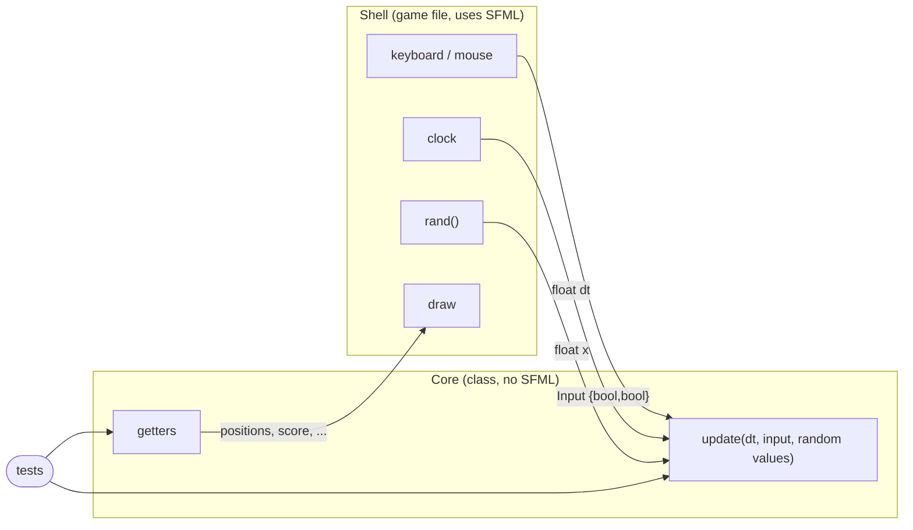

# Lecture notes: Seams, and splitting a small app so it can be tested

These notes cover the ideas behind [howto_split.md](howto_split.md). That guide is the step-by-step recipe for one game (Catcher). These notes are the *why* and the general method, so you can apply it to any small interactive program, including the 16 games in this repository.

Running example throughout: **Catcher** ([before](howto_split/before/catcher.cpp), [after](howto_split/after/catcher.cpp), [CatcherGame.h](howto_split/after/CatcherGame.h), [tests](howto_split/after/CatcherGame_test.cpp)).

---

## 1. The problem in one sentence

The code we most want to test (the **rules**) is welded to the code we can't test (the **window, keyboard, clock and random numbers**).

A unit test needs to do three things:

1. **Arrange** – put the program in a known situation.
2. **Act** – run a small, bounded piece of behaviour.
3. **Assert** – read back the result.

A typical game loop blocks all three. You can't put it in a known state (state is local to `main()` or hidden inside sprites), you can't run "one frame" (the loop runs until a human closes the window), and you can't read the result (it only appears as pixels). On top of that, the outcome depends on things the test can't control: what keys are held, how fast the machine is, and what `rand()` returns.

---

## 2. What is a seam?

### 2.1 Start from what you already know: testing a function

You have already tested functions like this:

```cpp
int addPoints(int score, int points)
{
    return score + points;
}

TEST(Score, AddsPoints)
{
    EXPECT_EQ(15, addPoints(10, 5));
}
```

This is easy to test, and it's worth asking **why**:

- **Everything the function needs comes in through its parameters.** The test chooses `10` and `5`.
- **Everything the function produces goes out through its return value.** The test reads `15`.
- **Same inputs, same answer, every time.** Run it a thousand times, on any computer: `15`.

Picture the function as a sealed box with one door in and one door out:

```
   10, 5  ──►  [ addPoints ]  ──►  15
  (test chooses)               (test checks)
```

The test stands at both doors. It controls everything going in and sees everything coming out. That is all a unit test needs.

### 2.2 Hidden inputs: when a function has a back door

Now try to test this one:

```cpp
float newFruitX()
{
    return rand() % 380;
}

TEST(Fruit, NewFruitX)
{
    EXPECT_EQ(???, newFruitX());   // what number do we expect?
}
```

There are no parameters, yet the answer changes every time. The function is getting an input from somewhere *other* than its parameter list: from `rand()`. That is a **hidden input** – a back door the test can't stand at.

Games are full of back doors. Here are three more, all written in the style of the games in this repo:

```cpp
// Hidden input: the real keyboard
void moveBasket(float& basketX)
{
    if (Keyboard::isKeyPressed(Keyboard::Key::Left))
        basketX -= 5;
}
```

To test this you'd need a person pressing Left while the test runs.

```cpp
// Hidden input: the real clock
void dropFruit(float& fruitY, Clock& clock)
{
    fruitY += 100 * clock.restart().asSeconds();
}
```

How far the fruit falls depends on how long it's been since the last call – which depends on how fast the computer is. Different answer every run.

```cpp
// Hidden input: global variable
int score = 0;

void catchFruit()
{
    score++;
}
```

This one *can* be tested, but every test changes the same global `score`, so the tests affect each other.

| Hidden input | Why a test can't control it |
|--------------|-----------------------------|
| `rand()` | you don't know (or choose) what it returns |
| `Keyboard::isKeyPressed` | a test can't press keys |
| `Clock` / `time(0)` | the real time is different on every run |
| mouse position | a test can't move the mouse |
| global variables | other code (and other tests) change them |
| state inside a sprite (`sprite.getPosition()`) | you need a real SFML object to set it up |

There are **hidden outputs** too. `window.draw(...)` and `window.setTitle(...)` send the result to the screen. A test can't look at the screen, so it can't check the result.

### 2.3 Closing the back door: turn the hidden input into a parameter

The fix is surprisingly simple. **Don't let the function fetch the value. Hand it the value.**

```cpp
// The rule, with the keyboard moved out
void moveBasket(float& basketX, bool leftHeld)
{
    if (leftHeld)
        basketX -= 5;
}
```

The keyboard is still read – just **one level up**, by whoever calls the function:

```cpp
// In the game:
moveBasket(basketX, Keyboard::isKeyPressed(Keyboard::Key::Left));
```

```cpp
// In a test:
TEST(Basket, MovesLeftWhenLeftHeld)
{
    float x = 100;
    moveBasket(x, true);
    EXPECT_FLOAT_EQ(95, x);
}

TEST(Basket, StaysStillWhenLeftNotHeld)
{
    float x = 100;
    moveBasket(x, false);
    EXPECT_FLOAT_EQ(100, x);
}
```

The same trick works for every hidden input:

| Before (hidden input) | After (parameter) | Game passes | Test passes |
|-----------------------|-------------------|-------------|-------------|
| `if (Keyboard::isKeyPressed(Left))` | `bool leftHeld` | `Keyboard::isKeyPressed(Left)` | `true` / `false` |
| `clock.restart().asSeconds()` | `float dt` | `clock.restart().asSeconds()` | `0.1f` |
| `fruitX = rand() % 380;` | `float newX` | `rand() % 380` | `170` |
| reads global `score` | member variable, or a parameter | – | – |

Notice what **didn't** change: the rule itself. `if (leftHeld) basketX -= 5;` is the same rule as before. We only changed **where the value comes from**.

And notice the game still uses the real keyboard, the real clock and real `rand()`. Nothing about how it plays changes.

### 2.4 So what is a seam?

The term comes from Michael Feathers, *Working Effectively with Legacy Code* (2004):

> A **seam** is a place where you can alter behaviour in your program without editing in that place.

Think of a seam in clothing: the line where two pieces of fabric are stitched together. You can unpick the stitches and sew on a different piece **without cutting the fabric** on either side.

In code, the **parameter list is the stitching**:

```
   the outside world          │ seam │          the rule
  (keyboard, clock, rand)  ───┼──────┼───►  moveBasket(x, leftHeld)
          or                  │      │
  a test (true, 0.1f, 170) ───┘      │
```

- On one side is the **rule** – the code we want to test. It never changes.
- On the other side is **where the values come from**. The game plugs in the real keyboard. The test plugs in `true`.

Feathers also names the **enabling point**: the place where you decide which side gets plugged in. For a parameter, that's simply **the line that calls the function**:

```cpp
moveBasket(basketX, Keyboard::isKeyPressed(Keyboard::Key::Left));   // game: real keyboard
moveBasket(x, true);                                                // test: chosen value
```

The function body can't tell whether it is being played or tested. That is exactly what we want.

> **In one line:** a seam is a place where the code *receives* something instead of *fetching* it, so that a test can hand it something different.

### 2.5 Why an app is harder to test than a function

You've tested functions. An app or game feels different, because:

- It **never returns**. `main()` loops until a person closes the window. A test can't call it and wait for an answer.
- It reads **hidden inputs on every frame**: keys, time, `rand()`.
- Its results go to **hidden outputs**: the screen.
- Its state lives in **local variables in `main()`** or inside sprites, where no test can reach it.

But look at what a game loop *really* is – the same small step, repeated 60 times a second:

```
while the window is open:
    look at the keyboard, the clock, rand()     ← hidden inputs
    apply the rules                             ← what we want to test
    draw                                        ← hidden output
```

So testing a game means testing **one step**. We want a function that says:

> *"Given the game as it is now, and these inputs, what does the game look like one frame later?"*

That function is `update`, and the whole of the split is about building it:

- every hidden input becomes a **parameter** (a seam),
- the state moves out of `main()` into a **class**, so a test can create one,
- and every hidden output becomes a **getter**, so a test can read the result instead of looking at the screen.

Then the game and the test use the **same** class in different ways:

```cpp
// The game: call update forever, with real inputs, and draw the result
while (window.isOpen())
{
    game.update(clock.restart().asSeconds(), readKeys(), randomFruitX());
    draw(game.basketX(), game.fruitX(), game.fruitY());
}
```

```cpp
// A test: call update a few times, with chosen inputs, and check the result
CatcherGame game(0);
game.update(0.1f, LEFT, 0);
EXPECT_FLOAT_EQ(130, game.basketX());
```

### 2.6 The seams in Catcher

Look at the *after* version. `CatcherGame::update` has this signature:

```cpp
void update(float dt, Input input, float nextFruitX);
```

Each parameter is a seam:

| Seam | In the real game the value comes from... | In a test the value comes from... |
|------|------------------------------------------|-----------------------------------|
| `dt` | `clock.restart().asSeconds()` | a constant, e.g. `0.1f` |
| `input` | `Keyboard::isKeyPressed(...)` | `LEFT`, `RIGHT`, `NO_KEYS` |
| `nextFruitX` | `rand() % 380` | a number you chose, e.g. `170` |

And the outputs that used to go only to the screen now come out through getters: `basketX()`, `fruitX()`, `fruitY()`, `score()`, `lives()`, `isGameOver()`.

In the *before* version there are no seams. The rules ask the keyboard, the clock and `rand()` directly, and the results only exist on screen, so there is nowhere for a test to get in or out.

### 2.7 Common misunderstandings

- **"A seam is a special C++ feature."** No. It's a design idea. In this course a seam is nearly always just a function parameter.
- **"I need interfaces, virtual functions or a mocking library."** Not for small games. Plain values (`bool`, `float`, `int`, small structs) are enough.
- **"If I move `rand()` out, the game won't be random any more."** It still is. `rand()` is still called – by the game file, not by the rules.
- **"Then the random part isn't tested."** Correct, and that's fine. There's nothing in `rand()` for you to test. What you test is *what the rules do with whatever number they get*: "a new fruit appears at the x I gave you".
- **"Seams are only for tests."** Tests are the first beneficiary, but the same seam lets you add a replay, an AI player, or a "slow motion" mode, just by passing different values in.

### 2.8 Other kinds of seam (for later)

Feathers describes several kinds. You only need the first for now; the others are here so you recognise the names.

| Kind | How you swap behaviour | Example | Use it when |
|------|------------------------|---------|-------------|
| **Parameter seam** | pass the value in instead of fetching it | `update(dt, input, nextFruitX)` | almost always – simplest, no extra machinery |
| **Object seam** | pass in an object (interface, `std::function`, template) whose methods the code calls | `Board(RandomSource& rng)`; a `FakeRandom` in tests | the code needs *many* values, or needs to ask at awkward times |
| **Link seam** | link a different `.cpp` / library in the test build | test build links `fake_engine.cpp` instead of `Connector.cpp` | you can't change the calling code |
| **Preprocessor seam** | `#ifdef TESTING` swaps code | rarely worth it | last resort |

---

## 3. The shape we are aiming for



Two names you will see for this pattern:

- **Functional core, imperative shell.** The core makes decisions from plain data. The shell does all the talking to the outside world (screen, keyboard, OS, randomness).
- **Humble Object.** The part that is hard to test (the shell) is made so thin and dumb – "humble" – that it barely needs testing. All the interesting logic moves somewhere testable.

The game loop then reads as three lines of intent:

```
input  = read the outside world          (shell)
core.update(dt, input, randomValues)     (core)
draw(core's getters)                     (shell)
```

**If your loop reads as input → update → draw, you have found the seam.**

---

## 4. Why split at all?

| Benefit | What it means in practice |
|---------|---------------------------|
| **Testable** | You can call one frame, from a known state, and check the result. |
| **Deterministic** | Same inputs → same outputs, every run, on every machine. A failing test fails every time, so you can debug it. |
| **Fast** | No window, no GPU, no 60 fps limit. Hundreds of tests run in milliseconds. A test can simulate 10 seconds of game time instantly. |
| **Runs anywhere** | The test target doesn't link SFML. It runs on a CI server with no screen (see the Linux CI job in this repo). |
| **Easier to read** | The rules are in one place, named, without drawing code interleaved. |
| **Easier to change** | You can change *how it looks* without risking *how it plays*, and vice versa. |
| **Reusable** | The same core could drive a different front end: a console version, a replay system, an AI player, a network server. |

The split is not "for the tests". The tests are the first *second user* of your class. If a class is easy for a test to use, it is usually easy for anything else to use too.

---

## 5. Why `rand()` (and the clock, and the keyboard) must stay outside

These three are all **hidden inputs**: values a function uses that don't appear in its parameter list. A function with hidden inputs can't be tested reliably, because the test can't control them.

### 5.1 What is wrong with `rand()` inside the rules

1. **You can't predict it.** After a catch, where is the new fruit? The test can't know, so it can't check.
2. **You can't choose it.** To test "a fruit over the basket is caught", you need the fruit *over the basket*. With `rand()` inside, you'd have to keep running until luck puts it there.
3. **It is global, hidden state.** `rand()` keeps its own state between calls. Anything else that calls `rand()` – another test, another object, a library – changes what your code gets next. Tests start to depend on the order they run in.
4. **`srand(time(0))` makes every run different.** A test that fails once in 50 runs ("flaky") is worse than no test: people learn to ignore it.
5. **Seeding is not a fix by itself.** `srand(42)` makes runs repeatable, but you still can't *choose* the value you need, and the sequence differs between compilers and platforms (`rand()` is implementation-defined). A test that passes on Windows can fail on Linux.

### 5.2 The fix: separate *choosing* the random value from *using* it

The shell **chooses** (calls `rand()`), the core **uses** (receives a number):

```cpp
// shell
float randomFruitX() { return float(rand() % int(CatcherGame::WIDTH - CatcherGame::FRUIT_SIZE)); }
game.update(dt, input, randomFruitX());

// test
game.update(0.1f, NO_KEYS, 170);   // I decide: the next fruit lands at 170
```

Now "random" is just another input, like a key press. The core is a **pure function of its inputs**: same inputs, same result.

### 5.3 Options, from simplest to most flexible

| Option | Looks like | Good for | Watch out |
|--------|-----------|----------|-----------|
| **Pass the result** | `update(dt, input, nextFruitX)` | one random value per frame or event | the shell may generate values that go unused – fine |
| **Ask for it when needed** | core sets `needsNewFruit()`; shell calls `spawnFruit(rand()...)` | random values needed rarely, at moments the core decides | two calls per frame; the core must be valid in between |
| **Pass it to the constructor** | `Board(std::vector<int> mines)` | random *setup*: shuffled deck, mine layout, starting grid | test must build the data – often a good thing, it documents the scenario |
| **Inject a generator** | `Board(std::mt19937& rng)` or `std::function<int(int)> randomBelow` | code that needs many random values in a loop (e.g. shuffling) | for tests use a fixed seed or a fake that returns a scripted sequence |

Start with the first. Move down the table only when the simpler option gets awkward.

### 5.4 Things that are "random" in disguise

Treat all of these the same way – read them in the shell, pass the value in:

- `rand()`, `std::random_device`, `std::mt19937` created inside the class
- `time(0)`, `std::chrono::system_clock::now()`
- `sf::Clock`, `getElapsedTime()`
- mouse position, keyboard state, window size
- file contents, network replies, the chess engine's answer

The question to ask about any value is: **"Could this be different next time I run the program with the same inputs?"** If yes, it is a hidden input and belongs in the shell.

### 5.5 A note on time

Time is the most common hidden input in games. Two rules:

- **The core never owns a clock.** It receives `dt` (seconds since last frame) as a `float`.
- **Timers become accumulated `dt`.** Instead of `if (clock.getElapsedTime() > 0.3s)`, keep `float timer` in the core and do `timer += dt; if (timer > 0.3f) { timer = 0; step(); }`. Now a test can call `update(0.3f, ...)` and know exactly one step happened.

Choose `dt` values in tests that make the arithmetic easy: `0.1f` at speed `300` is exactly `30` pixels.

---

## 6. How to find the seam in any small app

### 6.1 Label every line

Read the main loop and label each line with what it depends on:

| Label | Means | Ends up |
|-------|-------|---------|
| **RULE** | changes or decides game state | in the core |
| **KEY** | keyboard, mouse, events | shell → passed in as plain data |
| **TIME** | clock, `dt`, timers | shell → `float dt` passed in |
| **RAND** | `rand()` and friends | shell → the *result* passed in |
| **DRAW** | sprites, shapes, `window.draw`, text | shell, reading the core's getters |

Lines with **two or more labels** are where the tangle is. The split is just untangling those lines one at a time.

### 6.2 Follow the state

List every variable the rules read or write. For each one ask: *where does it live?*

- In a local in `main()`? → becomes a member of the core.
- In a global array? → becomes a member (or a parameter).
- **Inside an SFML object** (`sprite.getPosition()`, `shape.move()`)? → this is the most important one to fix first. Give it its own plain variable; set the sprite's position from it only when drawing.

### 6.3 Ask "what goes in, what comes out?"

For the whole game, write down:

- **In:** what the outside world gives the rules each frame (keys, `dt`, random numbers, mouse clicks as grid coordinates...).
- **Out:** what the outside world needs back (positions to draw, score, "game over", "play a sound").

The *ins* become `update`'s parameters. The *outs* become getters. That **is** the seam – you've designed the class's interface before writing it.

### 6.4 Use the test list to design the interface

Write the rules as English sentences before you touch the code ("Holding Left moves the basket left at 300 px/s"). Each sentence tells you something the class needs:

- "...holding Left..." → the class needs to be *told* Left is held → an `Input` parameter.
- "...moves the basket..." → the test must *read* the basket's position → a `basketX()` getter.
- "...a new fruit starts at the top..." → the test must *choose* where → a random value passed in.

### 6.5 Where seams tend to be in different kinds of game

| Game style | Typical core | Typical inputs | Typical outputs |
|------------|-------------|----------------|-----------------|
| **Grid / board** (minesweeper, fifteen puzzle, bejeweled, netwalk, mahjong, tetris board) | a 2D array + rules | "cell (r,c) clicked", "rotate", "drop"; random layout passed to constructor | cell contents, game over |
| **Real-time movement** (arkanoid, snake, doodle jump, tron, asteroids, catcher) | positions + velocities | `dt`, held keys, random spawns | positions, score, lives |
| **Turn-based against an engine** (chess) | board + move legality | a move as from/to squares | board, whose turn, result |

Notice the grid games convert the mouse into **cell coordinates in the shell** (`x / tileSize`). The core only ever deals in rows and columns, never pixels from the mouse.

---

## 7. How to implement the split

The full recipe is in [howto_split.md](howto_split.md). The order matters – each step makes the next one easy:

1. **Take state out of SFML objects** into plain variables.
2. **Name the magic numbers.**
3. **Read input into plain data** at the top of the frame.
4. **Pass in time and randomness.**
5. **Replace SFML types** in the rules with your own tiny structs (`Rect`, `Point`).
6. **Gather the rules into one function** (`update`) operating on one struct – still in the same file.
7. **Move it to a header and make it a class.** No `#include <SFML/...>`.
8. **Compile it in the test project.** If it won't compile without SFML, step 7 isn't done.
9. **Write tests** from the test list.

After every step: build, play through a short **manual test script**, commit. These are *refactorings* – behaviour must not change.

---

## 8. Tips and tricks

### Keeping the split safe

- **Small steps, frequent commits.** If a step breaks the game and you can't see why within a few minutes, `git restore .` and take a smaller step.
- **Never fix bugs while splitting.** Write them down. Fix them later, in their own commit, with a test that fails first. Mixing a fix into a refactor means you can't tell which change broke things.
- **Keep it in one file until it works.** Extract `update()` and the state struct inside the game file first. Only move to a header once the game plays the same.
- **Characterization tests.** The first tests you write should record what the game *does*, even if it looks odd (Catcher's restart leaves the basket where it was). Changing behaviour is a separate, deliberate decision.

### Designing the core

- **Plain data only across the seam.** `int`, `float`, `bool`, `enum`, and small structs you wrote. If an `sf::` type crosses the seam, SFML leaks into the core.
- **The compiler is your checker.** The test target doesn't link SFML. If the header compiles there, it is free of SFML – no need to trust your eyes.
- **Getters, not public fields.** Drawing and tests can read; only `update`/`restart` can write. That keeps the rules in one place.
- **Report events as outputs.** If the shell needs to play a sound or flash the screen when something happens, don't call SFML from the core. Have `update` return something (e.g. `enum class Event { None, Caught, Missed }`) or expose `lastEvent()`. The shell reacts.
- **Let tests set up awkward situations.** If a test needs "a board with one mine at (2,3)", give the class a constructor that takes the board. This is often the same seam the shell uses for the random layout.
- **Constants live in the core.** Sizes and speeds are part of the rules. The shell reads them (`CatcherGame::WIDTH`) to size the window, so the two can never disagree.
- **Not everything moves.** Colours, texture rectangles, pixel offsets for drawing – those are presentation. Leave them in the shell.
- **Name it after the thing it models:** `MineField`, `TetrisBoard`, `Snake`. Not `GameLogic`, `Manager`, `Helper`.
- **Don't over-engineer.** For a small game you rarely need interfaces, virtual functions, dependency-injection frameworks or mocks. A parameter is a seam.

### Writing the tests

- **Choose inputs that make the maths obvious.** `dt = 0.1`, speed `300` → `30` pixels. `dt = 1.0` with a wall → certainly clamped.
- **Run many frames with a safety limit.** When something takes many frames, loop until it happens *or* a frame limit is reached, so a broken rule fails instead of hanging.
- **Test edges.** Walls, the first and last row, zero lives, touching-but-not-overlapping rectangles, an empty or full board. Bugs live at edges.
- **`EXPECT_FLOAT_EQ` for floats.**
- **One rule per test.** If the name needs "and", consider two tests.
- **A hard-to-write test is design feedback.** It usually means a missing seam: a value you can't control or a result you can't read.

### Warning signs that a seam is missing

| You see in the rules... | It means... |
|-------------------------|-------------|
| `#include <SFML/...>` | SFML has leaked into the core |
| `rand()`, `time(0)`, `Clock` | a hidden input |
| `sprite.getPosition()` used in a decision | state is living in a graphics object |
| `getGlobalBounds()` | a size comes from a texture – find the number and name it |
| `window.draw` inside logic | an animation is mixed with a decision – keep the animation in the shell, move only the decision |
| a function reading a global array | a hidden dependency – make it a member or a parameter |
| a constructor that calls `rand()` | random setup – pass the values to the constructor |

---

## 9. Summary

- A **seam** is a place where behaviour can be changed without editing the code there. For us: a function parameter.
- Split the program into a **core** (rules, plain data, no SFML) and a **shell** (window, keyboard, clock, `rand()`, drawing).
- Everything that can differ between runs – keys, time, randomness – is a **hidden input**. Read it in the shell, pass the *value* to the core.
- The core then behaves like a pure function: **same inputs, same outputs**. That is what makes it testable, debuggable and fast.
- Find the seam by **labelling lines**, **following the state**, and asking **what goes in, what comes out**.
- Do it in **small, behaviour-preserving steps**, with a manual test script and a commit after each.

---

## 10. Discussion questions / exercises

1. In Catcher, `randomFruitX()` is called every frame, even when no fruit is needed. Does this change how the game *plays*? Does it change the *sequence* of fruit positions compared with the original? Why is that acceptable here?
2. Redesign Catcher's seam using the "ask for it when needed" option (`needsNewFruit()` / `spawnFruit(x)`). What gets better? What gets worse?
3. Pick one of the 16 games. Label ten lines of its loop with RULE / KEY / TIME / RAND / DRAW. Which lines have more than one label?
4. For the same game, write the "what goes in / what comes out" lists. Sketch the `update` signature and the getters.
5. Find a place in any game where state lives inside a sprite. What plain variable would replace it?
6. Suppose the shell needs to play a sound when a fruit is caught. Change `CatcherGame` so the shell can find out, without the core including any audio headers.
7. Why is `srand(42)` in a test *not* a good enough fix for `rand()` inside the rules? Give two reasons.

### Further reading

- Michael Feathers, *Working Effectively with Legacy Code* – chapter 4, "The Seam Model".
- Gary Bernhardt, "Boundaries" (talk) – functional core, imperative shell.
- Gerard Meszaros, *xUnit Test Patterns* – the Humble Object pattern.
